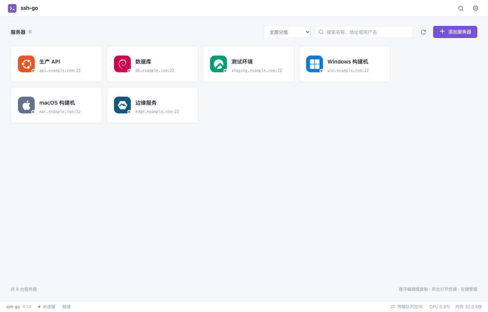
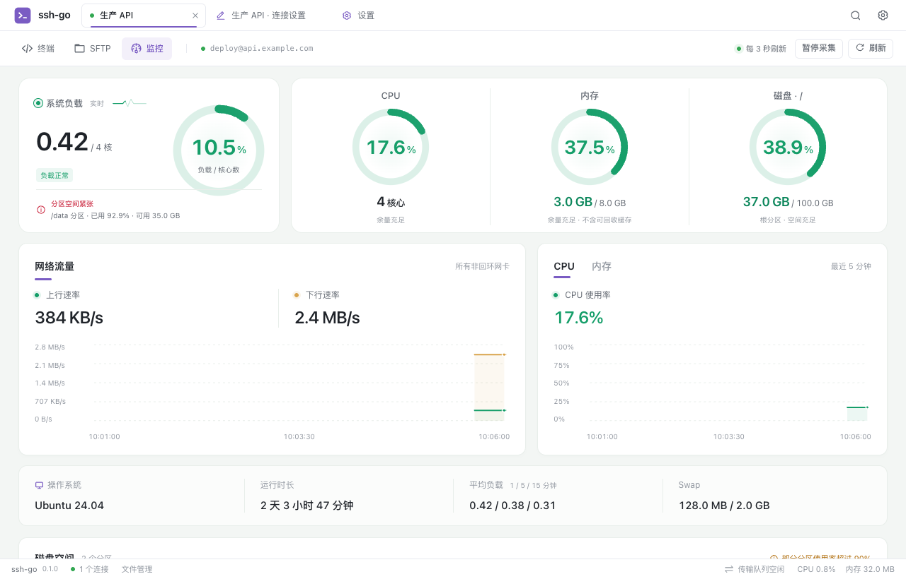
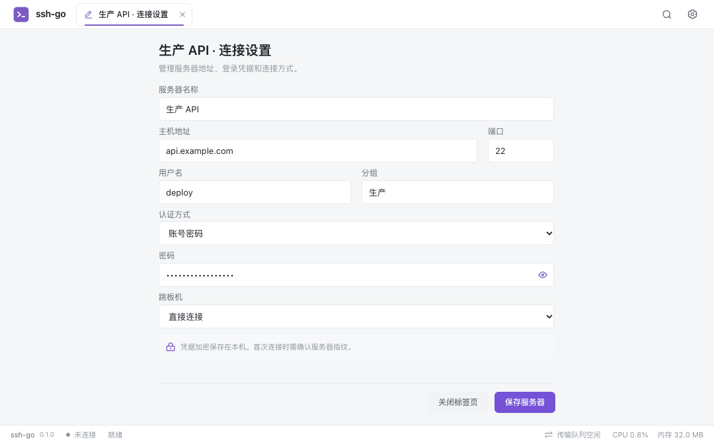
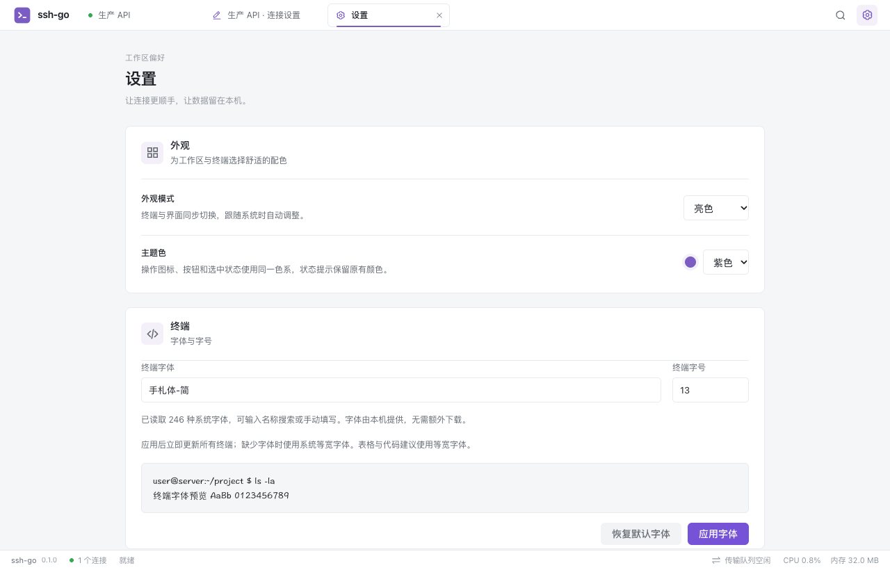
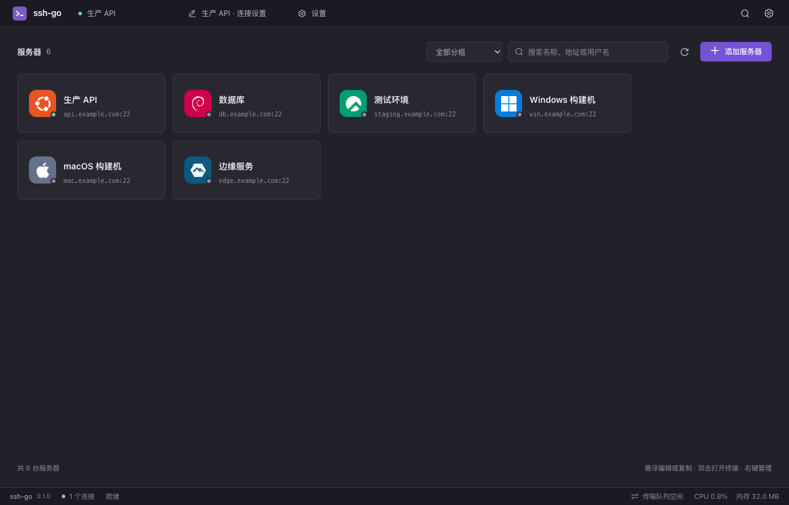
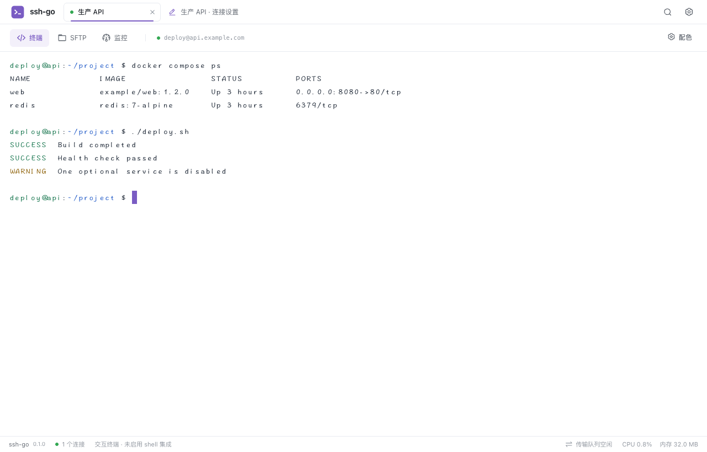
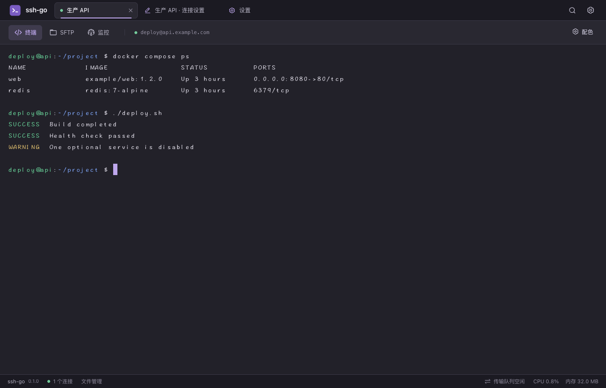
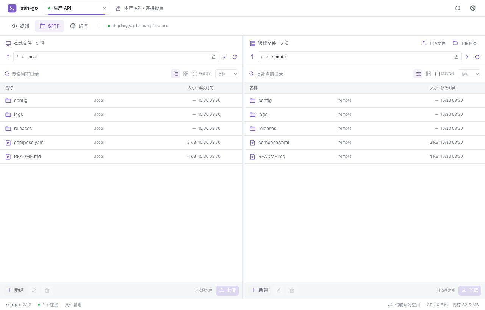
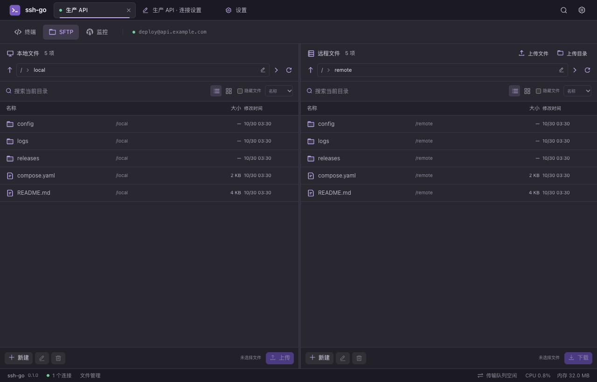
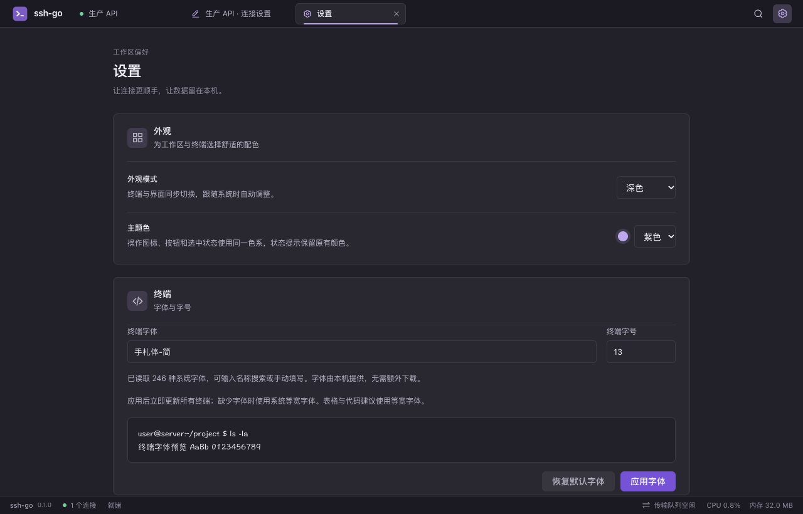

# ssh-go

基于 **Go + Wails 2 + Vue 3** 的桌面 SSH / SFTP 客户端。集中管理服务器连接，在同一工作区使用多会话终端、双栏文件管理和本地端口转发。

当前版本 **0.1.0**。服务器以紧凑卡片排列，SSH 会话、连接设置与全局设置共用顶部标签栏；终端、SFTP 和服务器监控在同一连接内切换。支持亮色、深色、跟随系统与五种主题色，也可读取本机字体并手动配置终端字体和字号。macOS 使用系统原生菜单与窗口控件，支持窗口缩放；Windows / Linux 和网页预览提供窗口内菜单。已在 macOS Apple Silicon 完成构建，Windows / Linux 桌面尚未验收。





截图由当前界面生成，使用隔离的演示连接和模拟终端、文件与监控数据；系统字体列表取自截图机器，不包含真实服务器凭据。

## 功能

| 模块 | 已实现 |
| --- | --- |
| 连接管理 | 自适应卡片、系统识别图标、分组与搜索、独立连接设置标签、悬浮编辑 / 复制、卡片与空白区域右键菜单、JSON / OpenSSH 配置导入导出 |
| SSH 认证 | 密码、私钥与加密私钥、SSH Agent、最多 8 层跳板机链 |
| 服务器身份 | 首次连接逐跳确认指纹；指纹变化时阻止连接 |
| 终端 | 多会话、PTY 尺寸同步、3000 行回滚、输出流控、ANSI 颜色与显示高亮、系统字体读取、自定义字体与字号 |
| 工作区外观 | 亮色 / 深色 / 跟随系统、五种主题色、原生窗口外观同步、本机保存偏好 |
| 服务器监控 | Linux CPU / 内存趋势、网络收发速率、磁盘分区、Swap、系统负载与运行时长 |
| 文件管理 | 本地 / 远程双栏、列表 / 图标展示、虚拟滚动、搜索排序、多选、右键菜单、新建文件 / 多级目录、重命名与删除 |
| 文件传输 | 跨面板拖拽上传下载、文件 / 目录传输、4 项并发、进度、取消与重试、覆盖冲突检查、中断恢复 |
| 端口转发 | 通过搜索与操作调用，绑定本地回环地址，支持自动分配端口和显式停止 |
| 本地存储 | 配置原子写入、AES-256-GCM 加密凭据、连接身份变化时清理旧凭据 |

### 服务器与连接设置

连接成功后自动读取并缓存操作系统，服务器卡片使用对应系统图标；尚未识别时显示通用服务器图标。卡片保留名称与地址，随窗口宽度自动换行。

- **连接**：双击卡片，或聚焦卡片后按 Enter；已经连接时返回原终端。单击卡片不切换页面，也不留下选中高亮。
- **编辑与复制**：悬浮卡片时显示编辑、复制图标；右键卡片可编辑、复制或删除服务器。
- **列表操作**：右键空白区域可添加服务器、刷新列表或清除筛选。
- **连接设置**：编辑后打开「服务器名 · 连接设置」标签，可与其他连接和全局设置来回切换，并保留未保存的表单内容。关闭该标签不会断开 SSH 会话。
- **已保存密码**：打开连接设置后以黑点显示，点击眼睛图标可查看，再次进入时恢复遮挡。凭据在本机加密保存，连接配置导出不包含密码。

连接设置在默认窗口尺寸下可完整展示常用密码认证表单和底部的「关闭标签页」「保存服务器」按钮。窗口更小或表单更长时，只滚动表单区域，底部操作保持可见。



顶部标签支持鼠标切换；聚焦标签后，左右方向键、Home / End 切换，Delete 关闭当前标签。连接较多时可横向滚动，长名称省略并在悬停时显示完整名称与地址。点击左上角 ssh-go 返回服务器列表，右上角搜索按钮打开搜索与操作，齿轮打开全局设置。⌘ / Ctrl + N 添加服务器，⌘ / Ctrl + K 搜索，⌘ / Ctrl + , 打开设置。

### 终端字体与外观

在「设置 → 终端」中输入名称搜索本机字体，或手动填写字体名称；字号支持 **8–32**。预览确认后点击「应用字体」，立即更新所有已打开的终端，保留连接和已有输出，偏好自动保存在本机。

默认字体为 **手札体-简（Hannotate SC）**，字号 **13**；也可使用原来的 **Menlo**，或选择 Monaco、Courier New 等本机已安装的等宽字体。字体数量取决于当前系统；字体文件由本机提供，无需随软件打包，也不会因读取更多系统字体而增加字体资源体积。未安装的字体会回退，表格与代码建议使用等宽字体。



在「设置 → 外观」中选择亮色、深色或跟随系统，界面、终端与原生窗口同步切换，保留当前连接与输出。蓝、绿、红、橙、紫五种主题色统一用于操作图标、按钮、选中态与焦点；状态提示和终端 ANSI 输出保留各自的语义颜色。

### 监控与文件操作

连接服务器后，在「终端 / SFTP / 监控」中选择「监控」，查看宝塔风格的服务器概览：顶部左侧突出系统负载，右侧合并展示 CPU、内存与根分区的大号环形仪表；下方以宽幅流量图搭配资源趋势，系统信息收成紧凑信息带，采集控制位于会话导航最右侧，账号与主机地址紧随「监控」并用竖线分隔。圆环随采样平滑更新，减少动态效果的系统偏好下关闭过渡。趋势图支持悬停查看同一时刻的读数，也可聚焦图表后使用方向键、Home / End 浏览采样点，Esc 收起读数。Linux 指标通过现有 SSH 连接只读采集，无需安装服务；一次采样结束后间隔 3 秒刷新，保留当前连接最近 5 分钟的趋势。首次采样建立基线，CPU 与网络速率从第二次采样开始显示。切换页面、隐藏窗口或手动暂停时停止发起采样，断开后保留最后数据并注明状态；重新连接开始新记录。网络为非回环网卡合计，虚拟网卡可能重复计入流量。macOS / Windows 远端暂不支持监控。

SFTP 两侧可独立切换列表或图标展示，偏好保存在本机。路径栏以 `/ › opt › duidui › legacy-php` 这样的面包屑展示，单击任一目录段即可直接跳转到该层，不弹出目录选择窗口。双击路径栏空白处，或聚焦路径栏后按 F2 / Enter，可编辑并选中完整路径；Enter 或右侧箭头前往，Esc 取消。路径分段支持方向键、Home / End 聚焦和 Enter 跳转；长路径可横向滚动，跳转失败保留编辑内容供修改。右键文件区可在当前目录新建目录（支持 `data/yiqiban/config` 多级路径）、新建空文件、切换展示模式或刷新；右键选中项还可上传 / 下载、重命名和删除。图标模式支持方向键、Home / End 移动，Shift 扩展选择，Enter 打开目录，Shift + F10 打开右键菜单。将选中的文件或目录拖到另一侧，即复制到对侧当前目录：本地 → 远程为上传，远程 → 本地为下载，保留源文件。同名普通文件需确认覆盖；已有目录不会自动合并。传输仍进入现有队列，完成后刷新目标目录。

连接断开时保留原标签、终端输出与文件列表，在页面顶部显示断线原因和「重新连接」按钮；连接过程中禁用重复点击，失败后仍可重试。重连成功后留在原来的终端、SFTP 或监控页，SFTP 回到原来的本地和远程目录。若只是远程终端退出而 SSH 仍连接，则提供「重新打开终端」。后台每 30 秒进行一次有回复的 SSH 存活探测，10 秒未回复则关闭失效连接并更新页面；空闲本身不会触发强制断开。

<details>
<summary>查看更多当前界面：深色模式、终端与 SFTP</summary>

服务器列表与已打开的工作区标签：



终端默认使用手札体-简，保留 ANSI 颜色与输出高亮：




本地与远程双栏文件管理：




深色设置与系统字体预览：



</details>

## 快速开始

需要 Node.js 22.12+、Go 1.26.1、Wails CLI 2.12.0；macOS 需要 Xcode 命令行工具。在项目根目录执行：

```sh
GOTOOLCHAIN=go1.26.1 go install github.com/wailsapp/wails/v2/cmd/wails@v2.12.0
export PATH="$(go env GOPATH)/bin:$PATH"
npm --prefix frontend ci
make run
```

桌面脚本固定使用兼容 Wails 绑定分析器的 Go 1.26.1，支持系统安装更新版本的 Go。首次运行缺少生产资源时会先构建前端；显式设置的 `GOTOOLCHAIN` 会保留。

```sh
make build                       # 构建桌面包
npm --prefix frontend run dev     # 仅预览网页，端口 1421
make help                        # 查看全部入口
```

macOS 构建产物为 `build/bin/ssh-go.app`，当前为本机自签名开发包，尚未接入签名公证和正式安装包分发。网页预览可查看界面，实际 SSH、文件操作和原生对话框需要桌面环境。

## 验证

首次运行界面测试需要安装 Playwright Chromium：

```sh
cd frontend
npx playwright install chromium
cd ..
make check
```

也可以使用已安装的 Chrome：

```sh
SSH_TOOLS_CHROMIUM='/Applications/Google Chrome.app/Contents/MacOS/Google Chrome' make check
```

`make check` 依次执行前端类型检查与构建、`go vet ./...`、Go 竞态检查和界面回归。Go 测试使用本地隔离的 SSH / SFTP 服务；界面测试使用模拟的 Wails 桥接。测试覆盖连接取消与迟到回包、认证和指纹、端口转发、终端流控、文件传输、覆盖冲突、中断恢复、连接设置标签与密码显示、卡片及空白区域右键菜单、系统字体读取与终端字体切换、监控采样与暂停、外观同步、主题色和键盘焦点。

仓库包含 [GitHub Actions 工作流](.github/workflows/check.yml)，配置为在推送与 Pull Request 时执行 macOS 构建、测试、桌面打包和本机签名校验；运行结果见仓库的 [Actions 页面](https://github.com/ServCore/ssh-go/actions)。也可先使用上述命令在本机验证。

## 工程结构

```text
ssh-go/
├── main.go / app.go       # 桌面入口、生命周期与原生 RPC
├── menu.go                # macOS 系统菜单与前端命令事件
├── internal/core/        # SSH、SFTP、存储、转发和传输恢复
├── frontend/             # Vue 源码、前端配置、依赖和界面测试
├── build/                # 图标与平台配置；bin/ 为构建产物
├── scripts/              # Wails 构建包装脚本
├── docs/                 # 使用说明、架构、性能记录与项目素材
├── .github/workflows/    # macOS 构建、测试与打包检查
├── go.mod / go.sum       # Go 依赖
├── wails.json            # 桌面项目配置
└── Makefile              # 统一开发、构建和检查入口
```

前端与后端保持独立目录，生成的依赖、构建产物、Wails 桥接和测试报告均被忽略。详细文件职责见 [目录说明](docs/STRUCTURE.md)。

## 性能与边界

文件列表使用虚拟滚动和浅层响应式快照。刷新时用路径集合单次遍历保留选中项；传输完成只通知目标端点与目录，连续完成会合并刷新，隐藏面板和窗口延迟到再次显示时读取。在双栏各 10 万个文件的受控生产资源测试中，前端 JS 堆中位数从 **142.28 MiB 降至 34.07 MiB，减少约 76%**。这是 Chromium 前端 JS 堆的对比，不代表整个桌面应用的总内存降幅；本轮未测得显著的空闲总占用降低。测试方法和复现命令见 [内存记录](docs/MEMORY.md)。

传输恢复支持恢复原文件或清理临时文件，**不提供断点续传**。不合并或覆盖已有目录，不传输符号链接或特殊文件；远端目录提交依赖服务器的 SFTP rename 语义。服务器特有的认证与 SFTP 行为仍需在实际环境验证。

状态栏只统计主进程（含原生窗口），不包含 WebView；macOS 显示当前物理占用，Linux 显示当前 RSS，回退时明确注明口径。

## 文档

- [配置、凭据和传输恢复](docs/DATA.md)
- [架构与技术取舍](docs/ARCHITECTURE.md)
- [目录与构建入口](docs/STRUCTURE.md)
- [开发与贡献](docs/CONTRIBUTING.md)
- [主题与图标用色](docs/THEMING.md)
- [内存对比与复现](docs/MEMORY.md)
- [迁移与验收记录](docs/MIGRATION.md)
- [项目介绍与简历素材](docs/PORTFOLIO.md)

## 许可证

项目许可证尚未选定。第三方依赖保留各自授权，主要依赖见 [依赖说明](docs/DEPENDENCIES.md)。
