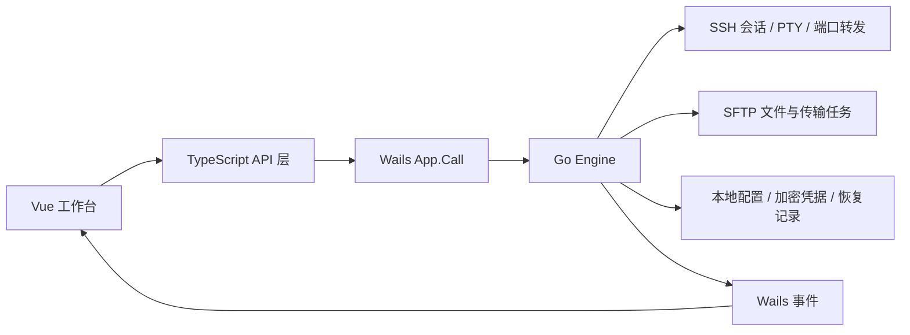

# 架构与技术取舍

## 数据流

`main.go` 嵌入 `frontend/dist/` 并启动 Wails；`app.go` 管理启动、退出和原生文件对话框。前端经 `frontend/src/lib/api.ts` 调用 `App.Call(command, args)`，Go 的结构化错误保留代码和详情，供认证、指纹与恢复流程处理。

`internal/core/engine.go` 持有会话、终端、转发和传输任务。前端组合式状态位于 `frontend/src/composables/workspace.ts`，负责工作区选择、连接尝试、迟到结果过滤和任务状态合并。

## 外观与主题

`frontend/src/themes.css` 集中定义亮色与深色的语义颜色。布局、表单、Arco 弹窗和抽屉共用这些变量；`appearance.ts` 管理外观选择、系统外观监听与偏好缓存，工作区加载桌面偏好时检查选择版本，避免迟到响应覆盖用户的新选择。持久化写入排队执行。

终端更新现有 xterm 实例的主题与显示高亮调色板，保留会话、回滚与原始输出，不通过重新挂载应用切换主题。

## 连接生命周期

每次连接尝试具有独立 ID 和取消状态。取消后到达的成功结果会主动断开，避免旧请求重新打开会话。后端连接使用 context 和超时；跳板机按顺序连接，每一跳独立核对服务器身份。

凭据仅在认证成功且连接身份仍匹配时保存。服务器地址、端口或用户名变化时清理旧凭据与相关缓存。SSH Agent 使用桌面进程的 `SSH_AUTH_SOCK`。

## 终端与流控

终端使用 xterm，接收后端 PTY 字节流。前端完成写入后确认对应字节，后端限制未确认输出为 256 KiB，避免快速输出持续堆积。通过面包屑返回服务器列表、切换设置或从下拉切换会话时保留终端实例；关闭会话时释放事件订阅、观察器与终端对象。

命令执行状态读取 OSC 133 / 633 shell 集成信号。没有集成时不根据键盘输入猜测命令是否执行。显示高亮只改变渲染，不改写原始终端输出或复制内容。

## 服务器监控

`internal/core/monitor.go` 经 `get_server_metrics` RPC 在现有 SSH 连接上打开独立 exec 通道，执行固定的只读 Linux 探测命令。CPU、内存、运行时长和负载来自 `/proc`，磁盘容量来自 `df -Pk`。CPU 按两次累计时间差计算整机 0–100% 使用率，排除已包含在 user/nice 中的 guest 时间；内存优先使用 `MemAvailable`，旧内核回退到空闲与可回收缓存估算。网络按网卡分别计算计数差，忽略回环、新出现和重置的计数器；较长采样间隔重新建立基线。

每个连接仅允许一个采样任务；输出有界，超时为 5 秒。超时关闭监控通道，保留共享 SSH 连接。尚未完成的通道打开操作仍占用该连接的监控名额，直到返回或连接关闭，避免重试堆积。磁盘或网络不可用时显示警告，其余指标继续使用；非 Linux 系统返回明确的不支持状态。

`ServerMonitor.vue` 按需加载，在前一次请求结束 3 秒后发起下一次采样；切换会话 / 工作区、隐藏窗口或手动暂停时停止发起新请求，忽略迟到结果。每个会话独立保留最近 5 分钟、最多 101 个快照。图表使用真实采样时间，空值和较长间隔断开曲线；断线或采样失败时明确标记最后成功数据。该功能不提供离线历史或后台告警。

资源压力提示由 `features/monitor/health.ts` 统一评估，涵盖 CPU、每核负载、内存与所有磁盘分区，不等同于业务服务的健康检查。前端每次收到快照后设置一次到期计时，超过 15 秒未更新即标记未知，不新增轮询请求；卸载时清理到期计时。暂停、断线和失败立即将当前指标转灰，恢复采集后等待新的成功快照再显示实时状态。阈值与用色约定见 [主题与图标用色](THEMING.md)。

## 传输与提交

任务队列最多同时运行 4 项传输，最多保留 128 项待处理任务。复制使用有界缓冲；取消关闭当前操作使用的资源，已有 SSH 会话可继续使用。

目标先写入同目录暂存文件，完成后再提交。覆盖普通文件时先保留原文件备份，并把阶段写入恢复日志；恢复操作检查目标是否已出现、连接身份是否匹配。重试会重新传输，恢复记录不等于断点续传。

本地提交使用不替换已有目标的重命名。远端普通文件在服务器支持时使用硬链接提交，否则使用 SFTP rename；远端目录的提交语义仍依赖服务器实现。

## 前端与内存

文件目录数据作为整体替换的不可变快照，使用 `shallowRef`，防止对所有屏幕外文件生成深层代理。Vue Virtual 控制渲染行数。设置、抽屉、弹窗、终端与文件工作区按需加载。

主进程资源和 WebView 内存分开理解：状态栏不包含 WebView，前端性能测试的 JS 堆也不包含引擎与 GPU 的全部占用。基准范围和数据见 [MEMORY.md](MEMORY.md)。

## 验证范围

后端协议测试使用临时目录和本地 SSH / SFTP 服务；界面测试模拟 Wails 桥接，以可控制的迟到回包和乱序事件验证交互。两者分别覆盖协议行为与前端状态，不能替代真实服务器兼容性验收。当前桌面验收范围为 macOS Apple Silicon。
